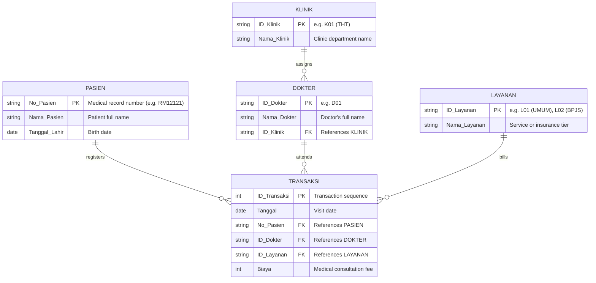

# healthcare-database-etl
# Healthcare Operations Data Architecture & Bulk ETL Pipeline


An end-to-end relational database architecture, business logic automation layer, and batch ETL ingestion pipeline designed for high-throughput outpatient clinic operations (*Poliklinik*). 

This project implements the competencies required by the **Indonesian National Occupational Competency Standards for Associate Data Engineers (SKKNI No. 268/2020)**:
- `J.62DMS00.006.1` — Designing Databases
- `J.62DMS00.008.1` — Managing Master & Reference Data
- `J.62DMS00.009.1` — Managing Metadata & Data Dictionaries
- `J.62DMS00.010.1` — Database Implementation
- `J.62DMS00.011.1` — Data Integration & Bulk Ingestion
- `J.620100.020.02` & `J.62DMS00.019.1` — Advanced SQL Querying & Data Consumption

---

## 🏗️ System Architecture & Entity Relationship Diagram (ERD)

The database schema is normalized up to **Third Normal Form (3NF)** to eliminate anomalies, enforce referential integrity, and segregate Master Data, Reference Data, and Transactional Data.



---

## 🏛️ Data Classification & Governance Strategy

To ensure enterprise-grade data governance:
1. **Reference Data (Static):** Handled via `layanan` and `klinik`. These tables store domain-specific categorization codes that rarely change and drive application lookups.
2. **Master Data (Entity Core):** Handled via `pasien` and `dokter`. Contains persistent business entities with strict uniqueness constraints.
3. **Transactional Data (Volatile):** Handled via `transaksi`. Designed for fast append-only writes capturing daily outpatient interactions.

---

## 🛠️ Key Technical Features

### 1. Automated Stored Procedures (Business Logic)
Rather than executing raw application-level multiple queries, core clinical workflows are encapsulated inside MySQL Stored Procedures:

* **Patient Visit History (`CekRiwayatPasien`):**
  Accepts an input medical record number (`p_no_pasien`) to trace chronological clinic visits, assigned physicians, and invoiced amounts.
* **Doctor Revenue Aggregator (`HitungPendapatanDokter`):**
  Features parameterized `IN` (doctor name) and `OUT` (aggregated revenue total) parameters for financial reconciliation.
* **Streamlined Patient Check-in (`TambahKunjunganLama`):**
  Automates queue-to-transaction insertion for returning patients without redundant master-record overhead.

### 2. High-Throughput Bulk Data Ingestion (Batch ETL)
An automated batch ingestion pipeline ingests raw insurance coverage files (`layanan_tambahan.csv`) directly into the production database using MySQL's native high-speed reader:

```sql
LOAD DATA INFILE '/path/to/data/layanan_tambahan.csv'
INTO TABLE layanan
FIELDS TERMINATED BY ','
ENCLOSED BY '"'
LINES TERMINATED BY '\n'
IGNORE 1 ROWS;
```

---

## 🚀 Quickstart & Setup Guide

### Prerequisites
* MySQL Server 8.0+ or MariaDB 10.4+
* MySQL Workbench, DBeaver, or command-line client

### Step-by-Step Installation

1. **Clone the repository:**
   ```bash
   git clone https://github.com/rizkyrmdnn/healthcare-database-etl.git
   cd healthcare-database-etl
   ```

2. **Run schema migrations:**
   ```bash
   mysql -u root -p < sql/01_schema.sql
   ```

3. **Seed base data:**
   ```bash
   mysql -u root -p poliklinik_afiat < sql/02_seed_data.sql
   ```

4. **Register Stored Procedures:**
   ```bash
   mysql -u root -p poliklinik_afiat < sql/03_stored_procedures.sql
   ```

5. **Execute Batch ETL (Data Integration):**
   * Ensure `layanan_tambahan.csv` is placed in MySQL's allowed directory (`SHOW VARIABLES LIKE 'secure_file_priv';`).
   * Execute `sql/04_bulk_etl.sql`.

---

## 📊 Sample Analytical Queries

### A. Active Doctor Allocation by Department
```sql
SELECT 
    k.Nama_Klinik, 
    COUNT(d.ID_Dokter) AS Total_Dokter
FROM klinik k
LEFT JOIN dokter d ON k.ID_Klinik = d.ID_Klinik
GROUP BY k.Nama_Klinik;
```

### B. Outpatient Service Utilization (Public vs BPJS vs Private Insurance)
```sql
SELECT 
    l.Nama_Layanan,
    COUNT(t.ID_Transaksi) AS Total_Kunjungan,
    SUM(t.Biaya) AS Total_Revenue
FROM transaksi t
JOIN layanan l ON t.ID_Layanan = l.ID_Layanan
GROUP BY l.Nama_Layanan
ORDER BY Total_Revenue DESC;
```

---

## 👤 Author
**Rizky Ramdhani Koswara**  
* Information Systems Graduate, Universitas Gunadarma  
* [LinkedIn](https://linkedin.com/in/rizky-ramdhani-7b5a18239/) • [GitHub](https://github.com/rizkyrmdnn) • Email: rizkyrbi04@gmail.com